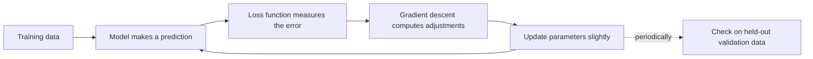

# AI Fundamentals

> Part 1 of 3 · Next: [Neural Networks and LLMs](02-neural-networks-and-llms.md) · [AI in Practice](03-ai-in-practice.md)

This guide explains the core ideas behind modern artificial intelligence without assuming any math or programming background. The goal is a working mental model: what these systems are, how they learn, and where their limits come from.

---

## AI, machine learning, and deep learning

These three terms are often used interchangeably, but they are nested inside one another.

**Artificial intelligence (AI)** is the broadest term. It refers to any computer system that performs tasks we usually associate with human thinking, such as recognizing speech, planning a route, or playing chess. AI includes approaches that do not learn at all. A 1990s chess program that follows hand-written rules and searches through possible moves counts as AI.

**Machine learning (ML)** is a subset of AI. Instead of a programmer writing the rules, the system learns patterns from examples. You do not tell a spam filter "emails containing 'free money' are spam"; you show it thousands of emails labeled spam or not spam, and it works out which features matter.

**Deep learning** is a subset of machine learning. It uses *neural networks* with many layers, loosely inspired by (but very different from) the brain. Deep learning drives most recent progress in image recognition, translation, and chatbots, because it can find useful patterns in raw data like pixels, audio, or text. The next guide covers neural networks in detail.

A simple way to remember it: all deep learning is machine learning, and all machine learning is AI, but not the other way around.

---

## Three main ways machines learn

Machine learning methods are usually grouped by what kind of feedback the system gets while learning.

### Supervised learning: learning from labeled examples

The system is given inputs paired with correct answers, and it learns to map one to the other.

- **Email spam filtering:** emails (input) labeled "spam" or "not spam" (answer).
- **House price estimates:** features like size and location (input) paired with actual sale prices (answer).
- **Photo tagging:** images labeled "cat," "dog," or "car."

Supervised learning is the most common style in practice. Its main cost is that someone has to produce the labels, which can be slow and expensive.

### Unsupervised learning: finding structure without answers

The system gets data with no labels and looks for patterns on its own, such as groups or unusual items.

- **Customer segments:** a store groups shoppers by buying habits without being told what the groups should be.
- **Fraud alerts:** a bank flags card transactions that look very different from a customer's usual pattern.
- **Organizing photos:** an app clusters pictures of the same face, even before you name the person.

Because there is no "right answer," the results need human interpretation. The algorithm finds groups; people decide whether those groups mean anything.

A closely related idea, **self-supervised learning**, creates labels automatically from the data itself, for example by hiding a word in a sentence and asking the model to predict it. This is how large language models are mostly trained, and it is covered in the next guide.

### Reinforcement learning: learning by trial and reward

An *agent* takes actions in an environment and receives rewards or penalties. Over many attempts, it learns which actions lead to better long-term results.

- **Games:** a program learns to play Go or video games by playing millions of rounds and being rewarded for winning.
- **Robotics:** a robot arm learns to grasp objects by trying and getting a reward when it succeeds.
- **Everyday analogy:** training a dog with treats. The dog is not told the rule; it figures out which behavior earns the treat.

Reinforcement learning is powerful but often needs huge numbers of attempts, which is why it works best where trials are cheap, such as simulations.

---

## How training works

"Training" is the process of adjusting a model until it makes good predictions. Every machine learning approach shares the same basic ingredients.

### 1. Data

Training starts with examples. Their quality matters as much as their quantity: if the data is biased, incomplete, or mislabeled, the model will learn those flaws. A face-recognition system trained mostly on one demographic will tend to perform worse on others.

### 2. A model with parameters

A **model** is a mathematical function that turns an input into an output. It contains adjustable numbers called **parameters** (or *weights*). Think of them as thousands, or billions, of tiny dials. Before training, the dials are set more or less randomly, so the model's predictions are poor.

### 3. A loss function

To improve, the model needs a way to measure how wrong it is. The **loss function** produces a single number that is large when predictions are far from the correct answers and small when they are close. If the model guesses a house costs $200,000 and it sold for $300,000, the loss is high.

### 4. Gradient descent

**Gradient descent** is the method for turning the dials. For each parameter, it calculates which direction of adjustment would reduce the loss, then nudges every dial a small step in that direction. The size of each step is controlled by the *learning rate*.

A common analogy: you are on a foggy hillside and want to reach the valley floor. You cannot see the whole landscape, but you can feel which way the ground slopes under your feet. You take a step downhill, check again, and repeat. The "hill" is the loss, and walking downhill is gradient descent.

This loop repeats over the training data many times, often millions of steps in total.

### 5. Generalization versus overfitting

The real goal is not to do well on the training examples but to do well on **new data the model has never seen**. This ability is called **generalization**.

The main danger is **overfitting**: the model memorizes the training examples, including their noise and quirks, instead of learning the underlying pattern. It is like a student who memorizes the answers to last year's exam and then fails when the questions change.

The opposite problem, **underfitting**, happens when the model is too simple to capture the pattern at all.

To detect overfitting, practitioners hold back some data the model never trains on. If performance keeps improving on training data but gets worse on this held-out data, the model is overfitting. Common remedies include more data, simpler models, stopping training earlier, and techniques that penalize overly complex solutions.

---

## Glossary

- **Algorithm:** a step-by-step procedure; in ML, the method used to train a model.
- **Model:** the learned function that maps inputs to outputs.
- **Parameters (weights):** the adjustable numbers inside a model that training tunes.
- **Training data:** the examples a model learns from.
- **Validation / test data:** examples held back to measure how well the model generalizes.
- **Label:** the correct answer attached to a training example in supervised learning.
- **Feature:** a measurable property of the input, such as a house's size.
- **Loss function:** a formula scoring how wrong the model's predictions are.
- **Gradient descent:** the iterative method of adjusting parameters to reduce loss.
- **Learning rate:** how big each adjustment step is during gradient descent.
- **Overfitting:** memorizing training data instead of learning general patterns.
- **Generalization:** performing well on new, unseen data.
- **Inference:** using a trained model to make predictions; no learning happens at this stage.

---

## Key takeaways

- AI is the broad field; machine learning is AI that learns from data; deep learning is machine learning with many-layered neural networks.
- Supervised learning uses labeled examples, unsupervised learning finds structure in unlabeled data, and reinforcement learning learns from rewards through trial and error.
- Training means repeatedly measuring error with a loss function and nudging parameters with gradient descent to reduce it.
- A model is only as good as its data: gaps and biases in the data become gaps and biases in the model.
- Success is measured on new data, not training data. Overfitting is the central risk.
- These systems find statistical patterns. They do not "understand" in the human sense, and their behavior comes from their training data and objectives.
