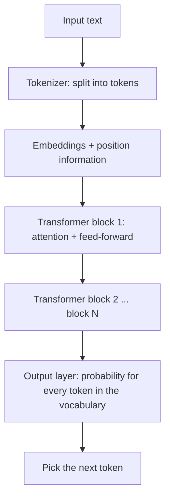
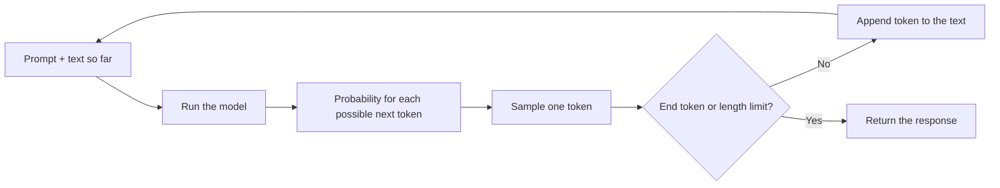

# Neural Networks and Large Language Models

> Previous: [01 – Fundamentals](01-fundamentals.md) · Next: [03 – AI in Practice](03-ai-in-practice.md)

Large language models (LLMs) such as the ones behind modern chat assistants are built from a surprisingly simple ingredient, the artificial neuron, repeated billions of times and tuned on enormous amounts of text. This chapter walks through that idea from the ground up.

## 1. Neurons, weights and layers

An **artificial neuron** is a tiny calculation. It takes several numbers as input, multiplies each one by a **weight**, adds the results together (plus a constant called a **bias**), and passes the total through an **activation function**.

The weights are the part that gets learned. A large weight means "this input matters a lot"; a negative weight means "this input argues against". A modern LLM has billions of these weights, often called **parameters**.

Neurons are arranged in **layers**. The first layer receives the raw input, each following layer takes the previous layer's outputs as its inputs, and the last layer produces the answer. Layers in the middle are called *hidden layers*. Having many of them is what "deep" refers to in *deep learning*.

### Why activation functions matter

If every neuron only multiplied and added, stacking layers would be pointless: any number of such layers collapses mathematically into a single one. An activation function adds a bend. A common choice, ReLU, simply outputs zero for negative numbers and passes positive numbers through unchanged. That small non-linearity lets a deep network represent very complicated patterns, such as the difference between a cat and a dog, or between a polite and a sarcastic sentence.

## 2. How a network learns: backpropagation

A freshly created network has random weights and produces nonsense. Training fixes this through a loop:

1. Show the network an example and let it make a prediction.
2. Measure how wrong it was with a **loss function** (a single number: bigger means worse).
3. Work out, for every weight, whether nudging it up or down would have reduced the loss.
4. Nudge every weight a tiny step in the helpful direction.

Step 3 is **backpropagation**. It starts at the output, where the error is known, and works backwards layer by layer, using calculus (the chain rule) to assign each weight its share of the blame. Step 4 is **gradient descent**: imagine standing on a foggy hillside and repeatedly taking a small step in whichever direction slopes downhill.

No single step is clever. The power comes from repeating this millions of times over huge datasets, so the weights slowly settle into values that make good predictions.

## 3. Tokens and embeddings

Neural networks only process numbers, so text must be converted first.

**Tokens.** Text is split into chunks called tokens. A token is often a whole common word ("the"), a piece of a rarer word ("un" + "believ" + "able"), or punctuation. As a rough rule of thumb, one token is about three-quarters of an English word. Each token in the model's fixed vocabulary has an ID number.

**Embeddings.** Each token ID is then mapped to an **embedding**: a list of hundreds or thousands of numbers that acts like coordinates in a high-dimensional space. These coordinates are learned during training, and they end up capturing meaning. Tokens used in similar ways, such as "cat" and "kitten", end up near each other, while unrelated tokens end up far apart.

## 4. The transformer and attention

Almost all current LLMs use an architecture called the **transformer**, introduced in 2017. Its key idea is **attention**.

Consider the sentence:

> *"The trophy didn't fit in the suitcase because **it** was too big."*

What does "it" refer to? A human knows it is the trophy, because big things don't fit into containers. If the sentence ended "because it was too small", "it" would mean the suitcase. The meaning of one word depends on other words, sometimes far away.

Attention lets every token look at every other token in the text and decide how much each one matters to it. When processing "it", the model can give high weight to "trophy" and "big", then blend information from those tokens into its own representation. Afterwards, the internal representation of "it" carries the idea "the trophy, which is too large".

A transformer stacks many identical **blocks**. Each block has two main parts:

- an **attention layer**, where tokens exchange information with each other, and
- a **feed-forward layer**, an ordinary neural network applied to each token separately, which further processes what was gathered.

Each block refines the representations a little more. Early blocks tend to capture grammar and local patterns; later blocks capture more abstract relationships. A transformer also uses many attention "heads" in parallel, so different heads can track different kinds of relationship at once.

## 5. How an LLM is built, in stages

### Stage 1: Pretraining

The model is trained on a vast collection of text (web pages, books, code and more) with one simple task: **predict the next token**. Given "The capital of France is", the correct next token is "Paris". Backpropagation adjusts the weights after every guess.

This sounds modest, but doing it well across trillions of tokens forces the model to pick up grammar, facts, writing styles, and some reasoning patterns, because all of these help predict what comes next. The result is a *base model*: knowledgeable but not yet a helpful assistant. Ask it a question and it might continue with more questions, as if completing a quiz page.

Pretraining is by far the most expensive stage, needing large clusters of specialised chips running for weeks or months.

### Stage 2: Fine-tuning

The base model is then trained further on a smaller, carefully curated set of examples of good behaviour, such as questions paired with helpful answers. This **supervised fine-tuning** teaches it the format and tone of a conversation.

### Stage 3: Alignment with feedback

Finally, developers shape the model's behaviour using feedback. In **reinforcement learning from human feedback (RLHF)**, people compare pairs of model responses and pick the better one. Those preferences train a *reward model*, which then guides further training of the LLM toward responses people prefer: more helpful, more honest, less harmful. Variants use AI-generated feedback guided by written principles, or simpler direct preference methods. These techniques improve behaviour substantially, but they do not guarantee it.

## 6. Generating text one token at a time

An LLM does not write a whole answer at once. It runs a loop:

At each step the model outputs a probability for every token in its vocabulary. After "The sky is", it might give "blue" 60%, "clear" 15%, "falling" 1%, and so on.

**Sampling** chooses one token from that distribution. Always picking the top choice tends to produce repetitive, flat text, so most systems sample with some randomness.

**Temperature** controls how much randomness. A low temperature sharpens the distribution toward the most likely tokens, giving focused and predictable output, which suits factual or coding tasks. A high temperature flattens it, giving more varied and creative output but also more mistakes. This is why the same prompt can produce different answers each time.

## 7. Limitations

**Hallucinations.** The model is trained to produce plausible continuations, not to check facts. When it lacks information, it can generate confident, fluent statements that are false, including invented citations or statistics. Alignment training reduces this but does not eliminate it.

**Knowledge cutoff.** A model only knows what was in its training data, which ends at a certain date. Unless it is connected to tools like web search, it cannot know about later events, and it may not reliably know where its own knowledge ends.

**Context window.** A model can only attend to a limited number of tokens at once: the prompt, any documents provided, the conversation so far and its own reply. Modern windows are large, but anything outside the window is invisible to the model, and very long inputs can still be handled less reliably than short ones.

**Other caveats.** Models can reflect biases in their training data, can be sensitive to how a question is phrased, and may make errors in careful multi-step arithmetic or logic. They do not have memory between conversations unless a product adds it explicitly.

## Key takeaways

- A neural network is layers of simple neurons; its behaviour lives in billions of learned **weights**, and activation functions let it model complex patterns.
- **Backpropagation** works out how each weight contributed to an error, and gradient descent nudges weights to reduce it, repeated millions of times.
- Text becomes **tokens**, and tokens become **embeddings**, numerical vectors that capture meaning.
- **Transformers** use **attention** so each token can draw information from the other tokens that matter to it, as in resolving what "it" refers to.
- LLMs are built by **pretraining** on next-token prediction, then **fine-tuning** and **alignment** training such as RLHF.
- Generation is a loop that picks **one token at a time**; **temperature** trades predictability for variety.
- LLMs can **hallucinate**, have a **knowledge cutoff**, and only see what fits in their **context window**, so verify important outputs.
