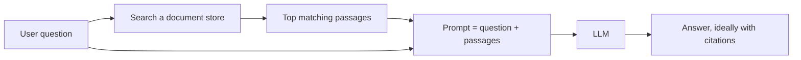
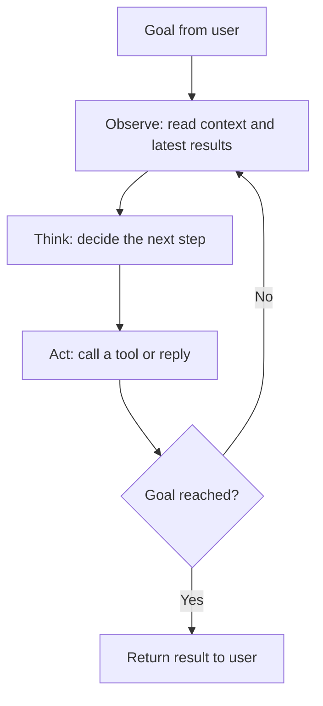

# AI in Practice

> Part 3 of 3. Previous: [01 – Fundamentals](01-fundamentals.md) · [02 – Neural Networks and LLMs](02-neural-networks-and-llms.md)

The earlier parts explained what a model is and how it learns. This part looks at what happens when a model is put to work inside a real product: how it is steered, connected to data and tools, evaluated, paid for, and used responsibly.

## From raw model to product

A large language model (LLM) on its own does one thing: given some text, it predicts what text should come next. Almost every useful AI product wraps that core in extra machinery. The most common layers are below.

### Prompting

A prompt is the input you give the model. Products usually combine several parts: a hidden *system prompt* set by the developer (tone, rules, the role to play), the conversation so far, and the user's latest message.

Good prompts are specific. They say who the audience is, what format is wanted, what to avoid, and often include an example or two. Small changes in wording can change the output a lot, which is why teams test their prompts the way they test code.

### Retrieval-augmented generation (RAG)

A model only "knows" what was in its training data, which has a cutoff date and does not include your company's private documents. RAG solves this by looking up relevant material first and handing it to the model along with the question.

The search step often uses *embeddings*: numerical representations of text where similar meanings sit close together, so a question about "annual leave" can find a policy that says "vacation days."

RAG reduces made-up answers but does not eliminate them. If the search returns the wrong passages, the model may confidently answer from the wrong source. Citations help people check.

### Tool use and agents

Models can be given *tools*: functions they are allowed to call, such as a web search, a calculator, a database query, or "send email." The model does not run the tool itself. It outputs a structured request ("call `search` with these words"), the surrounding software runs it, and the result is fed back in.

An *agent* is a system that repeats this many times to reach a goal, deciding its own next step each round:

Agents can handle multi-step tasks such as fixing a bug across several files or researching a topic. They also fail in new ways: an early mistake can compound, they can loop, and an agent with the power to act (delete files, spend money) needs limits and human checkpoints.

### Multimodal models

Many current models accept more than text. *Vision* models can read screenshots, charts, photos, and scanned documents. *Audio* models can transcribe speech, and some can listen and speak directly in real time. Separate image-generation models create pictures from text descriptions.

Under the hood, images and audio are usually converted into token-like pieces the model can process alongside words. Accuracy varies: models are good at describing a photo, weaker at precise tasks like counting small objects or reading dense tables.

## How AI is evaluated

### Benchmarks

A benchmark is a fixed set of questions with known answers, such as math problems, coding tasks, or exam-style multiple choice. Scores make models easy to compare and track over time.

### Human evaluation

For open-ended work (writing quality, helpfulness, tone) there is no single right answer, so people compare outputs. A common method shows raters two anonymous answers side by side and asks which is better. Using another model as a judge is cheaper but inherits that model's biases.

### Why benchmarks can mislead

- **Contamination.** Test questions leak onto the internet and into training data, so a model may have seen the answers.
- **Saturation.** When top models all score near 100%, the benchmark stops telling them apart.
- **Teaching to the test.** Developers can optimize for a famous benchmark without improving general ability.
- **Narrow fit.** A high score on exam questions says little about whether the model handles *your* documents, language, or edge cases.

The practical lesson: treat public scores as a rough filter, then test candidates on a small set of real examples from your own work.

## Costs and infrastructure

### Training versus inference

*Training* is building the model: running enormous amounts of text through it for weeks or months to adjust its parameters. It is done rarely, by a few organizations, and costs can reach tens or hundreds of millions of dollars for frontier models.

*Inference* is using the trained model to answer a request. Each request is cheap, but there are billions of them, so inference is where most ongoing cost sits for widely used products.

### GPUs

Both stages run mostly on GPUs (graphics processing units) and similar specialized chips. They are good at doing huge numbers of simple multiplications in parallel, which is exactly what neural networks need. These chips are expensive, power-hungry, and at times in short supply, which shapes what AI companies can offer and at what price.

### Tokens as the unit of cost

Models read and write in *tokens*, chunks of text roughly three-quarters of an English word on average. Commercial APIs charge per token, usually with output tokens priced higher than input tokens. Long documents, long chat histories, and agents that loop many times all add up. Smaller models are much cheaper and faster, and are often good enough for simple tasks like classification or extraction.

## Risks and responsible use

- **Bias.** Models learn from human-written data and can reproduce stereotypes or treat groups unequally, for example in hiring or lending screens. Outputs that affect people need auditing.
- **Privacy.** Anything you paste into an AI tool may be stored or reviewed depending on the provider's terms. Personal and confidential data should only go into tools your organization has approved for it.
- **Misinformation.** Models can produce fluent, plausible statements that are false ("hallucinations"), including fake citations. They also make it cheap to generate convincing fake text, images, and voices at scale.
- **Safety and alignment.** *Alignment* means getting a system to reliably do what its developers and users intend, and not do harmful things. Developers use techniques such as training on human feedback, written guidelines, and red-teaming (deliberately trying to break the model). These reduce risk but are imperfect: models can be tricked by cleverly crafted inputs, including instructions hidden in documents or web pages an agent reads ("prompt injection"). Risk grows as systems gain more autonomy and access.

## Practical tips for using AI at work

1. **Give context.** Say who it is for, what it is for, and what good looks like. Paste the relevant material rather than assuming the model knows it.
2. **Ask for structure.** Request bullet points, a table, or a specific length to get output you can use directly.
3. **Iterate.** Treat the first answer as a draft. Ask follow-ups, point out what is wrong, and ask it to revise.
4. **Verify facts.** Check names, numbers, quotes, and citations against a reliable source before relying on them.
5. **Use it where errors are cheap to catch.** Drafting, summarizing, brainstorming, and code with tests are good fits. Final legal, medical, or financial decisions need a qualified human.
6. **Protect data.** Follow your organization's policy on what can be shared with which tools.
7. **Keep humans in the loop for actions.** Review before an agent sends, deletes, buys, or publishes anything.
8. **Stay accountable.** You remain responsible for work you submit, whoever or whatever drafted it.

## Key takeaways

- Real AI products wrap a core model with prompts, retrieval, tools, and other software.
- RAG grounds answers in your own documents; it reduces but does not remove errors.
- Agents loop through observe, think, act until a goal is met; they are powerful but need limits and oversight.
- Multimodal models handle images and audio, with uneven accuracy on fine detail.
- Benchmarks are useful but can be contaminated, saturated, or irrelevant to your task; test on your own examples.
- Training is a rare, huge expense; inference is the ongoing cost, billed in tokens and run on GPUs.
- Bias, privacy, misinformation, and safety are real risks that call for policies and human review.
- Use AI as a fast, fallible assistant: give it context, check its work, and keep responsibility for the result.
